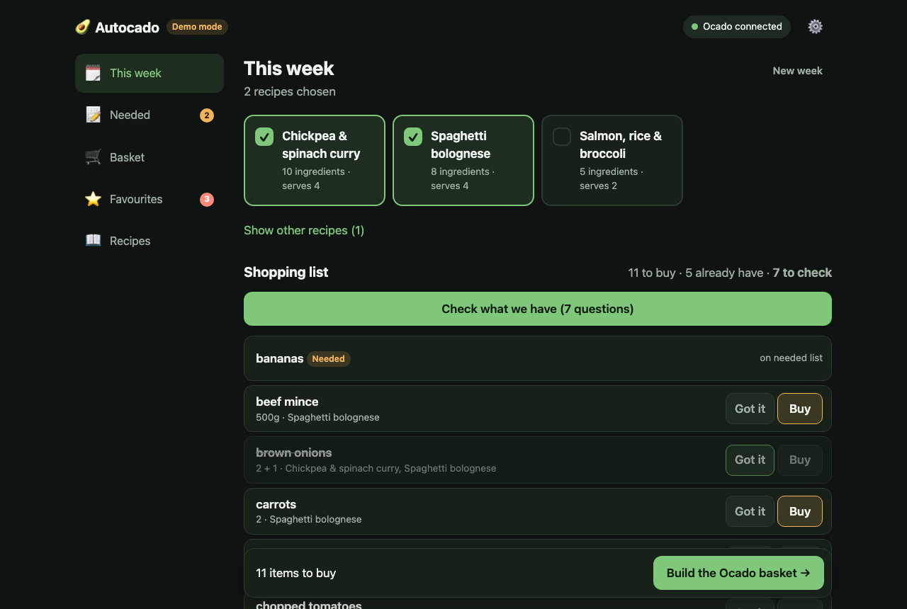
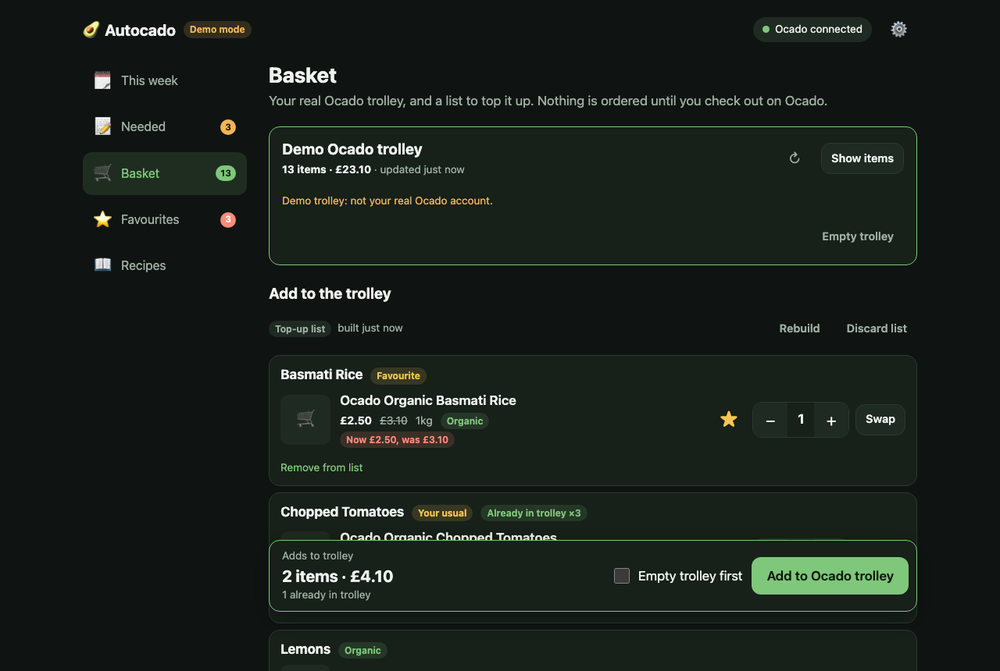
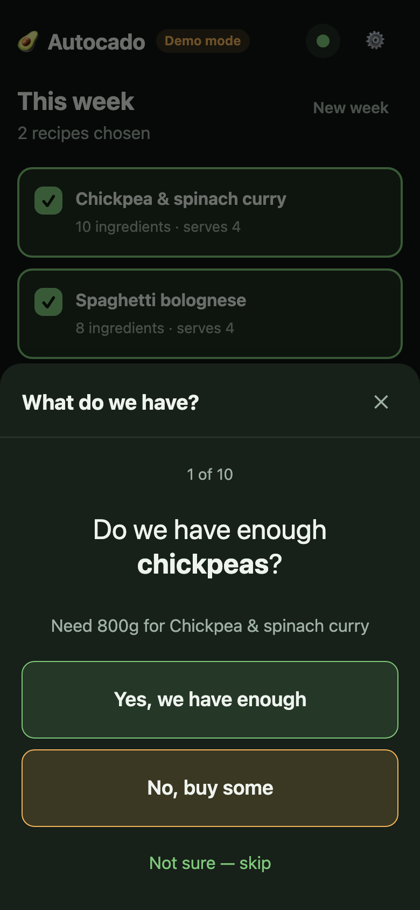

# Autocado 🥑

**Plan the week's meals, tick off what's already in the cupboard, and Autocado fills your Ocado trolley for you, choosing organic, your favourites and the products you usually buy.** You still check out on Ocado yourself: Autocado never places an order or pays for anything.



> **Unofficial.** Autocado isn't made by, affiliated with or endorsed by Ocado. It uses your own Ocado account the way the Ocado website does, which may go against Ocado's terms, and it can break whenever Ocado changes its site. It's for your own household shopping, at your own risk.

## What it does

- **This week:** tap the recipes you're cooking. The shopping list updates as you go and adds up amounts across recipes ("400g + 800g chopped tomatoes").
- **Got it / Buy:** answer for each ingredient, or go one big question at a time while standing at the fridge. Cupboard staples like salt and oil default to "got it".
- **Needed:** note anything that's run out. It goes into the next shop.
- **Basket:** matches every item to an Ocado product (your usual, then a favourite, then organic). Swap anything you like, then it fills your real Ocado trolley, adding only what isn't already there. It also shows what's in your trolley right now.
- **Favourites:** star products and see which ones are on offer.
- **Recipes:** add them from a web link, pasted text, a photo of a cookbook page, or by typing.
- **Any screen:** laptop, phone, tablet or kitchen mirror. Every open screen updates live.



## What you need

- A computer to run it on: a Mac or Linux machine (a Raspberry Pi works). Windows hasn't been tested.
- [Node.js](https://nodejs.org) version 22 or newer.
- [Firefox](https://www.mozilla.org/firefox/), signed in to your [Ocado](https://www.ocado.com) account.
- Optional: a [Claude API key](https://console.anthropic.com) to read recipes from photos. It costs about a penny per recipe.

## Set up (about 10 minutes)

### 1. Download and start Autocado

In a terminal:

```bash
git clone https://github.com/helloscottamos/autocado.git
cd autocado
npm install
npm start
```

No git? Click **Code → Download ZIP** at the top of this page, unzip it, then run `npm install` and `npm start` in that folder.

Open **http://localhost:3456** in your browser. Leave the terminal open: that's Autocado running. Next time you only need `npm start`.

### 2. Install the Firefox add-on

Ocado only trusts real browsers, so Autocado uses your Ocado account through a small Firefox add-on. This is what makes it reliable.

- **Easiest:** if the [Releases page](https://github.com/helloscottamos/autocado/releases) has a file ending in `.xpi`, open it in Firefox and click **Add**. It stays installed.
- **Otherwise:** in Firefox, type `about:debugging#/runtime/this-firefox` in the address bar, click **Load Temporary Add-on…** and choose `addon/manifest.json` from the Autocado folder. This lasts until Firefox restarts. [Permanent install instructions](docs/firefox-addon.md#install-permanently-free-about-10-minutes-once).

### 3. Connect to Ocado

In Firefox, sign in at **ocado.com** if you aren't already. Within about 30 seconds, Autocado's **Settings** page shows **Firefox add-on: Running**, and the top of the screen says **Ocado connected (Firefox)**.

Keep Firefox open (minimised is fine) whenever you want Autocado to read or fill your trolley.

### 4. Add your recipes

Go to **Recipes → + Add recipe** and paste a web link, paste the ingredients, or type them in. To read photos of cookbook pages, add your Claude API key in **Settings** first.

Check the **Search for** column: that's what gets looked up on Ocado, so keep it to supermarket words ("chopped tomatoes", not "400g tin of chopped tomatoes, drained").

### 5. Do your first shop

1. **This week:** tap the recipes you're cooking.
2. Tap **Check what we have** and answer each question.
3. **Basket → Find products on Ocado.** Look over the matches and tap **Swap** for anything you'd change.
4. Tap **Add to Ocado trolley**.
5. Open Ocado, check the trolley, book a delivery slot and pay as normal.

Autocado remembers what you chose, so next week's shop is quicker.

## Try it without an Ocado account

```bash
npm run demo
```

Then, in a second terminal:

```bash
npm run demo:seed
```

Open **http://localhost:3457** for a fake catalogue and trolley with some sample recipes. Nothing touches Ocado, and demo data is kept separate from your real data.

## Use it on your phone



By default only the computer running Autocado can open it. To use it from phones and tablets on your home Wi-Fi:

1. Copy `.env.example` to `.env`, and in it change `# HOST=127.0.0.1` to `HOST=0.0.0.0`.
2. Restart Autocado (Ctrl+C, then `npm start`).
3. On your phone, open **http://autocado.local** and add it to your home screen.

If a device can't find `autocado.local`, use the number address that the terminal and **Settings** show, such as `http://192.168.1.20:3456`. The computer needs to be awake with Autocado running.

Autocado has **no login**, so anyone on your Wi-Fi can use it. Don't put it on the internet. To use it away from home, a private network such as [Tailscale](https://tailscale.com) works well. More in [how it works](docs/how-it-works.md#sharing-on-your-home-network).

For a Raspberry Pi kitchen screen or mirror, see [docs/raspberry-pi.md](docs/raspberry-pi.md).

## Questions

**Does it ever order or pay?**
No. It only fills the trolley. Checking out, booking a slot and payment always happen on Ocado, by you. The add-on refuses any request to do those things.

**Do I need Firefox open all the time?**
Only when Autocado is reading or changing your trolley, or searching Ocado. Planning works without it. If Firefox is closed, Autocado can use its own sign-in instead (**Settings → Ocado account**), but Ocado's bot check makes that less reliable. See [how it works](docs/how-it-works.md#connecting-to-ocado).

**The top of the screen says "Ocado: refresh sign-in".**
Autocado is using its own sign-in and Ocado's bot check has gone stale. Open Firefox with the add-on, or use **Refresh sign-in** in Settings.

**Where's my data?**
On your computer, in the `data/` folder. Nothing is sent anywhere except Ocado and, if you add a key, Anthropic (only the recipes you import). **Settings → Reset all data** clears it all; you type `confirm` to go ahead.

**It stopped working.**
Ocado may have changed its website. Update with `git pull && npm install`, restart, and if it's still broken, [open an issue](https://github.com/helloscottamos/autocado/issues).

## More detail

- [How it works](docs/how-it-works.md): connecting to Ocado, the bot check, product matching, your data, settings and limitations.
- [The Firefox add-on](docs/firefox-addon.md): permanent install and exactly what it can access.
- [Raspberry Pi / kitchen mirror](docs/raspberry-pi.md).

## Development

```bash
npm test
npm run addon:lint
```

No build step: a Node.js server (`server/`) and a Preact + htm interface (`public/`). Layout and internals are in [docs/how-it-works.md](docs/how-it-works.md#project-layout).

## Credits and licence

Ocado access builds on [open-supermarkets](https://github.com/abracadabra50/open-supermarkets) (MIT). Autocado is released under the [MIT licence](LICENSE).
